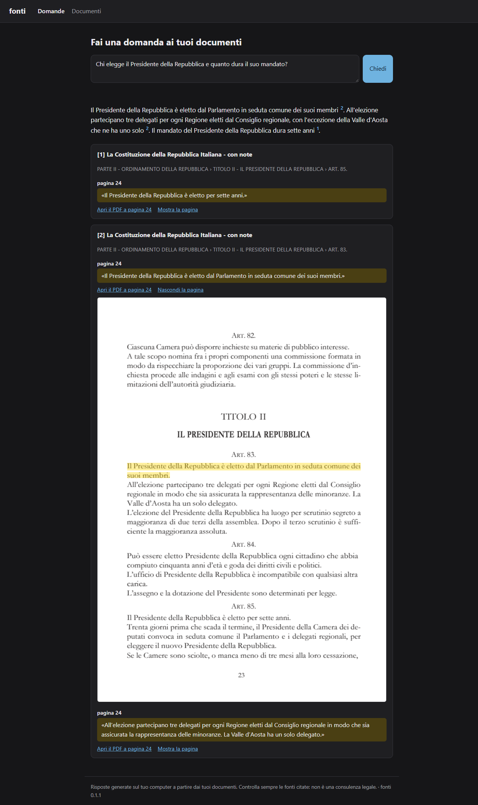
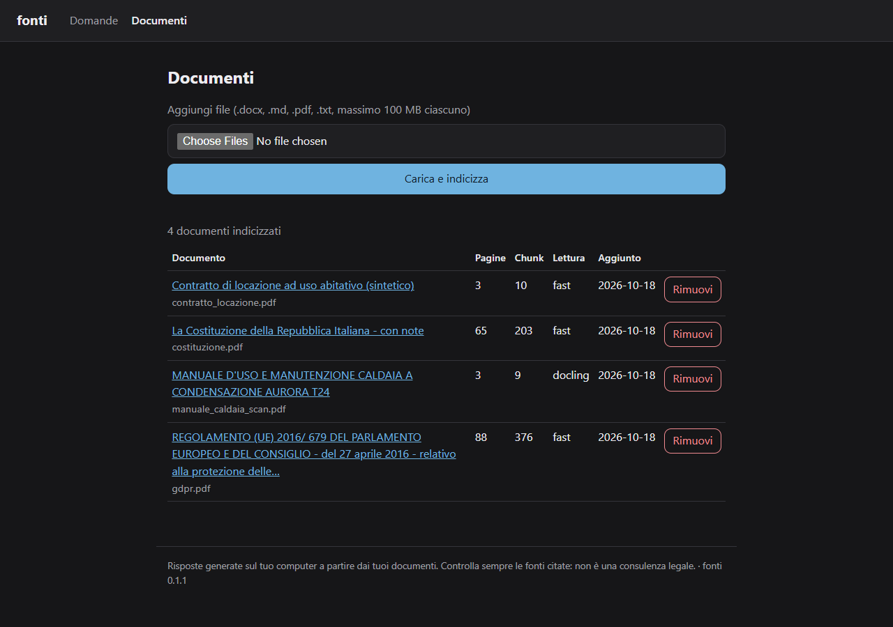

# fonti

[](https://github.com/rickykubler/fonti/actions/workflows/ci.yml)

**Ask questions about your own documents — in Italian, on your machine, with sources you can check.**

> **In italiano.** *fonti* è un sistema open source per fare domande ai propri documenti in
> italiano: contratti, normative, verbali, manuali. Gira interamente sul tuo computer, legge
> anche PDF difficili, scansioni e tabelle, e ogni risposta indica documento, pagina e passaggio
> esatto, copiato dal testo e mai inventato. Se i documenti non bastano, risponde «Non lo so».

**Status: alpha (0.1.0).** Progress and results are tracked in
[docs/ROADMAP.md](docs/ROADMAP.md).

## Why

- **Italian first.** Italian stemming and stopwords, legal headings (Parte, Titolo, Capo, Art.)
  and abbreviations (art., d.lgs., c.c.), hyphenation, running headers, scanned pages and tables.
- **Local first.** Embeddings, reranking and OCR run in-process; answers come from a local LLM
  through [Ollama](https://ollama.com). Nothing leaves your computer by default: remote LLMs are
  refused unless you opt in, models load offline once downloaded, the web UI listens only on
  127.0.0.1 and no library sends telemetry.
- **Verifiable citations.** Every sentence of an answer cites its source; the cited passage is
  copied verbatim from the document with its page, and you can open the PDF at that page with
  the passage highlighted. Without enough evidence the answer is «Non lo so».
- **Measured.** A golden set of 75 Italian questions over 8 documents (362 pages) drives every
  default (see [docs/evaluation.md](docs/evaluation.md)): recall@5 0.97, correct refusals
  100%, correctness 0.98, cited pages correct 89% with a 12B local model.

## How it works

1. **Ingest**: read the PDF text layer (Docling with OCR for scanned pages), recognise the
   document structure, split it into chunks that keep their pages, embed them and store
   everything in one SQLite file.
2. **Retrieve**: keyword search (BM25 with Italian stems) and semantic search, fused and
   reranked by a multilingual cross-encoder. If nothing is relevant enough, stop here.
3. **Answer**: a local LLM answers in Italian from the best six passages, citing them as `[n]`.
4. **Verify**: each cited passage is located verbatim in the source; sentences without support
   lose their citation, and answers without any verified citation become «Non lo so».

Details in [docs/architecture.md](docs/architecture.md).

## Getting started

Requirements: Windows, Linux or macOS; [uv](https://docs.astral.sh/uv/);
[Ollama](https://ollama.com); about 15 GB of disk for models. An NVIDIA GPU makes it fast
(developed on 16 GB of VRAM; the default LLM is an 8 GB download, and with less VRAM Ollama
runs part of it on the CPU); a CPU works too, slowly.

```
git clone https://github.com/rickykubler/fonti.git
cd fonti
uv sync --extra gpu --extra docling      # without an NVIDIA GPU: --extra cpu --extra docling
ollama pull gemma4:12b
uv run fonti models pull                 # embedding, reranker and OCR models (once, needs network)
uv run fonti doctor                      # checks that everything is in place
```

Then, with Ollama running (`ollama serve`, or the Ollama app):

```
uv run fonti ingest C:\Documenti\contratti
uv run fonti ask "Quanto dura il contratto di locazione?"
uv run fonti serve --open                # web UI on http://127.0.0.1:8000
```

Example answer:

```
La locazione ha durata di quattro anni, con decorrenza dal 1° febbraio 2026 [1].

Fonti:
[1] Contratto di locazione ad uso abitativo — Art. 2 - Durata
    pag. 1: «La locazione ha durata di quattro anni, con decorrenza dal 1° febbraio 2026, ...»
```

Other commands: `fonti docs` (list), `fonti remove ID`, `fonti reindex` (after changing
models or settings), `fonti --help`.

The first question after a start waits for Ollama to load the model (up to a minute);
then answers take a few seconds. `fonti serve` keeps the models loaded between questions.

## Web UI

`uv run fonti serve --open` does the same in the browser. The answer streams in; each
citation shows its page and the verbatim passage, opens the PDF at that page or shows the page
with the passage highlighted. The Documenti page uploads files and indexes them in the
background.





## Configuration

Copy [`fonti.example.toml`](fonti.example.toml) to `fonti.toml` and change what you need, or
use environment variables such as `FONTI_LLM__MODEL=qwen2.5:14b`. Useful settings:

| Setting | Default | |
|---|---|---|
| `llm.model` | `gemma4:12b` | any Ollama model, e.g. `qwen2.5:14b` (see the evaluation) |
| `parser.mode` | `auto` | `fast` (text layer only), `docling` (always) |
| `embedding.model` | `ibm-granite/granite-embedding-311m-multilingual-r2` | any sentence-transformers model, e.g. `BAAI/bge-m3` |
| `rerank.min_score` | `0.1` | higher = more «Non lo so» |
| `data_dir` | per-user app data folder | index and copies of your files |

Supported files: PDF (digital or scanned), DOCX, TXT, Markdown.

## Privacy

- Your documents and questions stay on your computer. The only network traffic is the
  one-time download of models from Hugging Face and Ollama.
- A remote LLM (any OpenAI-compatible API) is possible only with `llm.allow_remote = true`
  and an API key in `.env`; `fonti doctor` warns when it is on.
- The web UI has no authentication: it is meant for one person on one computer and refuses
  to listen on other addresses.

## Limits

- No handwriting. Complex tables (merged cells, tables split across pages) are read only
  partially; arithmetic over tables is not guaranteed.
- OCR of dense justified text can scramble word order (see the evaluation); answers usually
  stay correct but quoted passages are noisier.
- On EU regulations answers often cite a recital instead of the article that states the rule.
- Pages are numbered as in a PDF viewer (the 24th page is «pagina 24»), which can differ from
  the numbers printed on the pages.
- Each question is independent (no conversation memory). One user, one collection.
- Answers about contracts and laws are not legal advice: always read the cited passages.

## Development

```
uv sync --extra cpu
uv run pytest
uv run ruff check .
uv run mypy
```

See [CONTRIBUTING.md](CONTRIBUTING.md) and [docs/evaluation.md](docs/evaluation.md).

## License

[Apache-2.0](LICENSE). Third-party components, models and corpus terms are listed in
[NOTICE](NOTICE).
